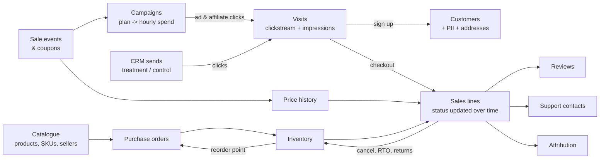

# ecommerce-simulator

A day-by-day simulator of an Indian online fashion shop. It writes **25 linked tables**
(catalogue, sale events, marketing, CRM, purchase orders, inventory, prices, customers,
clickstream, impressions, sales and support) that tell one consistent story, for data
analysis, data science and data engineering projects.

- **Realistic flow.** Marketing brings visitors; visitors see products (impressions), click,
  pick a size, add to cart, sign up, pay and order; stock moves; orders ship, arrive, get
  returned, refunded or exchanged; customers review and contact support.
- **Daily increments.** `load` builds the shop from its opening day to today; `increment`
  adds the days since the last run. Both give exactly the same data for the same days.
- **Validated.** Every run checks keys, time order, money, stock flows and behaviour across
  tables.
- **Hidden truth for evaluation.** Each customer's true taste is saved separately, so a
  recommender can be compared with perfect knowledge.

## Quickstart

```bash
pip install "ecommerce-simulator @ git+https://github.com/Meetpanchal58/ecommerce-simulator"
```

**Fastest: download the ready-made data** (refreshed every night by a GitHub Action, so it is
always up to yesterday):

```bash
ecommerce-sim download                 # full shop into ./data (about a minute)
```

```bash
ecommerce-sim download --size small    # a small shop for laptops and quick experiments
```

**Keep a local copy up to date.** If you downloaded (or simulated) earlier and did not
download again, add the missing days:

```bash
ecommerce-sim increment                # does nothing if already up to date
```

**Simulate it yourself** (for a different seed, size or opening day):

```bash
ecommerce-sim load --size small        # ~5 minutes   (medium ~15 min, full ~30 min)
```

**Extras:**

```bash
ecommerce-sim derive      # churn labels, monthly customer features, product affinity, weekly MMM table
```

```bash
ecommerce-sim validate    # re-run all consistency checks
```

```bash
ecommerce-sim textsql     # Text-to-SQL knowledge base + verified questions (pip install "ecommerce-simulator[sql]")
```

| Size | Products | Customers by late 2026 | Orders by late 2026 |
|---|---|---|---|
| small | 1,500 | ~6k | ~10k |
| medium | 5,000 | ~18k | ~30k |
| full | 10,000 | ~35k | ~60k |

## The story



## Tables

| Group | Tables |
|---|---|
| Catalogue | `product_master` (style) → `product_skus` (size), `sellers`, `warehouses` |
| Events & offers | `sale_events` (22 festivals and sales a year, live only on their days), `promotions` |
| Marketing | `campaigns`, `marketing_plan` (daily budget and targets), `marketing_spend` (hourly), `marketing_attribution` (4 models), `crm_sends` (treatment / control) |
| Inventory & price | `purchase_orders` (ordered + received), `inventory_history`, `inventory_live`, `price_history` |
| Customers | `customers`, `customer_pii` (fictional), `customer_addresses`, `auth_events`, `clickstream`, `impressions` |
| Sales & service | `sales` (one row per transaction line, status updated in place), `product_reviews`, `support_contacts`, `agents` |

Column-level documentation: [docs/schema.md](docs/schema.md). How it works and the design
choices: [docs/how_it_works.md](docs/how_it_works.md).

## Data folder

```
data/
  <table>.parquet                 whole tables (rewritten each run)
  <table>/month=YYYY-MM/part.parquet   big event tables, appended month by month
  derived/                        tables from `ecommerce-sim derive` and `textsql`
  _ground_truth/                  hidden customer taste and product quality (evaluation only)
  _state/                         the simulator's memory between runs (not for analysis)
```

Read everything with pandas (`pd.read_parquet("data/clickstream")` reads all months) or
DuckDB (`SELECT * FROM 'data/clickstream/*/*.parquet'`).

## Settings

| Setting | Default | Command-line flag / environment variable |
|---|---|---|
| Data folder | `./data` | `--data-dir` / `ECOMSIM_DATA_DIR` |
| Last day | today | `--today` / `ECOMSIM_TODAY` |
| Opening day | 2025-01-01 | `--start-date` / `ECOMSIM_START_DATE` |
| Seed | 42 | `--seed` / `ECOMSIM_SEED` |
| Size preset | full | `--size small/medium/full` / `ECOMSIM_SIZE` |
| Product styles | 10,000 | `--products` / `ECOMSIM_PRODUCTS` |
| Traffic scale | 1.0 | `--traffic-scale` / `ECOMSIM_TRAFFIC_SCALE` |

The product catalogue comes from the public Kaggle *Fashion Product Images* dataset, cleaned.

## License

MIT © Meet Panchal
